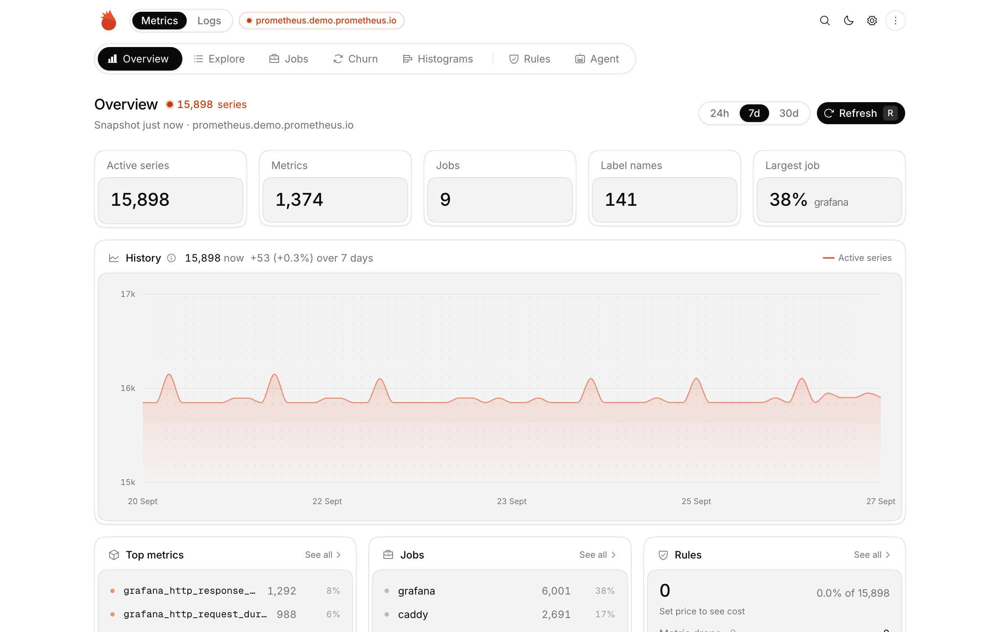

<div align="center">
  
  <h1>Cardinal</h1>
  <p><strong>Find and cut cardinality in Prometheus and Loki.</strong></p>
  <p>
    <a href="https://cardinal.ta3.dev">Open the app</a> ·
    <a href="#privacy">Privacy</a> ·
    <a href="#run-it-on-your-machine">Run it on your machine</a> ·
    <a href="#self-host">Self-host</a> ·
    <a href="#develop">Develop</a> ·
    <a href="#connect-an-agent">Connect an agent</a>
  </p>
</div>

<br />



Cardinal shows which jobs, metrics and labels make up your active series, and which services and labels create your log
streams and volume. Pick what to drop, check nothing depends on it, and export the rules.

## Features

- **Metrics:** series by job, metric and label, churn, and histogram bucket analysis
- **Logs:** Loki streams, labels, ingest volume and repeated line patterns
- **Safe drops:** checks alert rules and Grafana dashboards before you drop anything
- **Rules:** export Prometheus relabel configs, Grafana Alloy, Promtail and Loki limits, or apply Grafana Cloud Adaptive Metrics and Adaptive Logs
- **Grafana:** connect through your Grafana data sources, and export a dashboard that links back to Cardinal
- **Attribution:** split series, volume and cost by team, namespace or any label
- **Agents:** an MCP endpoint lets Claude or any MCP client analyse your data and propose rules for you to review

## Privacy

Pick how much you share; each option works on its own.

| Option | You give Cardinal | Cardinal's servers see |
| --- | --- | --- |
| **No credentials** | One query result you paste, and dashboard or rule files you upload | Nothing |
| **Direct** | Credentials, kept in your browser | Nothing: the browser calls your backend, which must allow CORS |
| **[Your own Cardinal server](#run-it-on-your-machine)** | Credentials, kept on your machine | Nothing: it serves the app, or is the proxy for cardinal.ta3.dev |

The hosted app has no proxy. Backends that don't allow browser requests, Grafana Cloud included, are reached
through a Cardinal server you run: open the app it serves, or keep using cardinal.ta3.dev with it as the proxy.

**No credentials.** Run `count by (job, __name__) ({__name__=~".+"})` as an instant query wherever you already
have access (Grafana Explore, `curl`, `promtool`) and paste the result under **Settings → Metrics → Paste a result**.
For dashboard usage, upload dashboard JSON, alert rule exports or Prometheus rule files under **Settings → Grafana**.
For logs, run `sum by (service_name) (bytes_over_time({service_name=~".+"}[24h]))` (and optionally the matching stream
count) and paste it under **Settings → Logs → Paste a result**. Drilldowns, history, labels, patterns and impact checks
need a live connection; volume, savings, rules and exports work.

Agents get metric, job and label names and series counts. Label values are only shared once you turn that on.

## Develop

Cardinal is a Vite app and one Cloudflare Worker.

```bash
bun install
bun dev            # app and worker on one port
bun run test
bun run deploy     # build and deploy to Cloudflare
```

Locally, put `PUBLIC_HOSTNAMES=localhost,127.0.0.1` in `.dev.vars`. Set `PUBLIC_HOSTNAMES` and `routes` in
`wrangler.jsonc` to your own domain.

## Run it on your machine

Cardinal runs locally as the whole app plus its proxy. It listens on `127.0.0.1` only, and your browser talks to
it instead of a Cardinal server, so backends on your network and backends without CORS work.

```bash
npx @ta3/cardinal          # then open http://localhost:9181
```

That needs Node 20 or later. Without Node, install the single-file binary (the script checks it against the
release's `SHA256SUMS`), download it from the [releases page](https://github.com/TA3/cardinal/releases)
(Linux, macOS, Windows), or use Docker below:

```bash
curl -fsSL https://github.com/TA3/cardinal/releases/latest/download/install.sh | sh
cardinal
```

Already working on cardinal.ta3.dev? **Continue on your machine** opens the local app with your URLs, rules and
prices carried over. Tokens never are.

### Use it as cardinal.ta3.dev's proxy

To keep using the hosted app, let it use your server as its proxy:

```bash
npx @ta3/cardinal --allow-origin https://cardinal.ta3.dev
```

Then set `http://localhost:9181` under **Settings → Your Cardinal server** (or **⋮ → Run Cardinal yourself**).
Proxy-mode requests then go from the page to your server and from there to the backend; Cardinal's servers
never see them. Only the sites you name may use it, and only while it runs. Chrome, Edge and Firefox ask once to
let the site reach apps on your device.

Safari blocks `http://localhost` from https pages outright. Serve it over HTTPS with a certificate your Mac trusts,
then use `https://localhost:9181` as the address:

```bash
npx @ta3/cardinal --allow-origin https://cardinal.ta3.dev --tls-cert cert.pem --tls-key key.pem
```

### Options

| Option | |
| --- | --- |
| `--allow-origin <site>` | Lets a site use it as its proxy. Repeat it for more. |
| `--allow-hosts <list>` | Only proxies to these backends: `host`, `host:port` or `*.domain`. |
| `--tls-cert <file>`, `--tls-key <file>` | Serves HTTPS with your certificate (PEM). |
| `--proxy-via <url>` | Reaches every backend through an HTTP proxy. Without it, `HTTPS_PROXY` and `NO_PROXY` apply. |
| `--proxy-ca <file>` | Trusts your internal CA for backends, as well as the usual ones. |
| `--proxy-timeout <s>` | Seconds to wait for a backend: 30 by default, at most 240. |
| `--debug` | Logs every API request: path, backend, status, time and why it failed. Never headers or credentials. |
| `--port <n>`, `--host <addr>` | Where it listens: 9181 on 127.0.0.1 by default. |
| `--public-hosts <list>` | Host names it is reached by, besides localhost and IP addresses. |
| `--open` | Opens the app in your browser once it starts. |

Most have an environment variable too (`CARDINAL_DEBUG=1`, `CARDINAL_PROXY_VIA=…`); `cardinal --help` lists them.
Without `--debug` it still says when it turns a site or host name away, and which flag would let it in.

A backend with a self-signed certificate: turn on **Skip certificate check** for that connection, under **Advanced**
in its settings. Only that connection skips it, through your Cardinal server; every other backend, Grafana Cloud
included, is still checked.

## Self-host

The container serves the app and its proxy, which reaches private and loopback hosts, so Prometheus, Loki and
Grafana on your network work without CORS.

```bash
docker run -p 127.0.0.1:9181:9181 ghcr.io/ta3/cardinal
```

Limit what it may reach with `--allow-hosts`, and let other sites use it as their proxy with `--allow-origin`.
Only the app it serves (and those sites) can use its proxy, but anyone who can open that app can, so keep it on a
trusted network or behind auth, and name its host with `--public-hosts`. Agent sessions need the hosted app.

## Connect an agent

Open **Agent → Start agent session**, then add the endpoint to your MCP client:

```bash
claude mcp add --transport http cardinal https://cardinal.ta3.dev/mcp \
  --header "Authorization: Bearer <token>"
```

The agent can read your snapshot, measure the impact of a change and propose rules. Nothing changes until you accept
it, and the tab has to stay open while the agent works.

## Rule formats

| Signal  | Export                                                                      | Apply                         |
| ------- | --------------------------------------------------------------------------- | ----------------------------- |
| Metrics | `metric_relabel_configs`, `write_relabel_configs`, Alloy `prometheus.relabel` | Grafana Cloud Adaptive Metrics |
| Logs    | Alloy `loki.process`, Promtail `pipeline_stages`, Loki `retention_stream`   | Grafana Cloud Adaptive Logs    |

Label drops that would merge Prometheus series are only exported as Adaptive Metrics aggregations, since relabelling them
creates duplicate samples.

<details>
<summary><strong>How it works</strong></summary>

<br />

- The React app is served as static assets from the Worker.
- The hosted Worker has no proxy. The self-hosted server's `/api/proxy/*` forwards read-only API calls for the
  app it serves (and sites named with `--allow-origin`): it only allows known paths and needs a short-lived token
  from `/api/proxy-token`.
- `/mcp` and `/api/sessions` run agent sessions. Each session is a Durable Object holding a WebSocket to your tab, which
  runs every query with its own connection, so the Worker and the agent never see your credentials.

```
app/          router and app shell
features/     one folder per page
components/   shared UI (shadcn in components/ui)
hooks/        data hooks, agent bridge, impact measurement
lib/core/     pure logic: PromQL, LogQL, rules, compilers, parsers
lib/sources/  Prometheus, Loki, Grafana and Adaptive Telemetry clients
lib/agent/    MCP tools and the tab-side executor
worker/       worker entry, proxy, sessions, MCP server
server/       self-hosted server and binaries (Bun), shares lib/proxy with the worker
```

</details>

## License

[GNU Affero General Public License v3.0](LICENSE). You can use, change and share Cardinal; if you run a changed
version for other people, including as a hosted service, you must offer them its source under the same license.

---

<p align="center">
  Also check out <a href="https://use.observer">Observer</a>, status pages from the same metrics.
</p>
